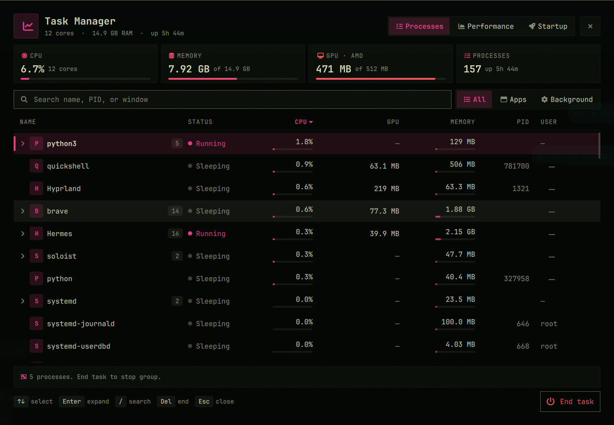

# Task Manager

A local Windows-style task manager for the Omarchy shell. Process names, CPU, memory, GPU, and startup apps stay on this machine. Nothing is sent over the network.



## Requirements

- Omarchy Quattro, with the Omarchy shell running.
- Python 3 at `/usr/bin/python3`.
- Optional: `/usr/bin/nvidia-smi`, used only when an NVIDIA card does not publish a sysfs busy percent. AMD and Intel cards are read from local sysfs without it.
- Optional: Hyprland's `hyprctl`, used only to attach window titles. The process list still works without it.

No extra packages are required. This repository has no install script and makes no network calls.

## Install

```bash
omarchy plugin add https://github.com/Murali-lns/omarchy-task-manager.git --enable
```

The standard Omarchy plugin command clones and validates the repository. It runs with ordinary user permissions.

## Remove

```bash
omarchy plugin remove io.github.murali-lns.task-manager
```

Removal deletes only the installed plugin directory and its shell entry. It does not delete the local sample file, and it does not change other user configuration.

## Update

```bash
omarchy plugin update io.github.murali-lns.task-manager
```

## Usage

- Bar icon (chart, not a CPU readout): left click toggles the overlay. The tooltip shows CPU, GPU memory when a local card reports it, and memory.
- `Super+Delete` opens it, when that shortcut is bound on your machine.
- `omarchy-shell shell toggle io.github.murali-lns.task-manager`
- **Processes** — same-name processes collapse into one row. The arrow, or a click on that row, expands the group. The GPU column is memory held on a card, not a busy percent, so clicking GPU sorts the largest holders first.
- **End task** asks the target process, or every live target in a grouped row, to quit (`SIGTERM`) after a confirm. **Force end** appears only after that ask, and only while the same start times are still alive (`SIGKILL`). Session-critical processes, other users, kernel threads, and PID 1 cannot be ended. A recycled PID is refused.
- **Performance** — CPU, each local GPU, memory, disk, and network. A GPU card leads with VRAM held. Busy percent stays in the subtitle.
- **Startup** — XDG autostart, read only. A user `Hidden=true` overrides the system entry of the same name.
- `Escape` closes the confirm, or the overlay. `Delete` or `t` asks to end the selected task. `Up`/`Down` (or `k`/`j`) navigates rows, `Right`/`Left` (or `h`/`l`) or `Space`/`Enter` expands and collapses groups, and `/` focuses search.

## Permissions and data

The plugin runs with the signed-in user's ordinary desktop permissions.

- It reads `/proc`, `/sys`, and XDG autostart desktop files. Autostart is read only.
- It writes only its own sample file, `~/.local/state/omarchy/task-manager/sample.json`, mode `0600`, so CPU and disk rates can be computed between polls.
- It does not write `shell.json`, Hyprland config, or any other user configuration.
- End task signals only the signed-in user's own processes, and only after confirmation. The signal goes through a pidfd opened on that task, and only when its start time still matches, so a recycled PID cannot receive it.
- It does not read credentials, prompts, or message contents, and it does not open a network connection.

## External dependencies

None beyond Omarchy and Python 3. `nvidia-smi` and `hyprctl` are optional local tools and are used only when they are already installed.

## Files

| File | Purpose |
|------|---------|
| `BarWidget.qml` | Chart icon; tooltip carries CPU, GPU, and memory |
| `Overlay.qml` | Processes, Performance, Startup |
| `Service.qml` | One poller shared by the bar and the overlay |
| `TaskModel.js` | Sort, filter, and formatting |
| `bin/taskman.py` | `/proc` snapshot, local GPU sample, and confirmed single-PID end |
| `preview.png` | Marketplace card image |
| `test_taskman.py` | Collector tests |
| `test_task_model.mjs` | Display-model tests |

## License

MIT. See [`LICENSE`](LICENSE).
